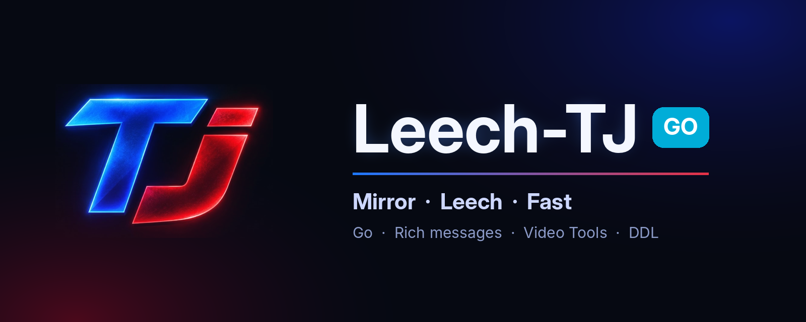

<p align="center">
  
</p>

<p align="center">
  <b>Our Telegram Mirror / Leech bot, rewritten in Go: fast, light, and the same look and settings as Leech-TJ.</b><br>
  <sub>Made by <a href="https://t.me/TJ_Bots">TJ Bots</a> · for our own use</sub>
</p>

<p align="center">
  <a href="https://t.me/Tj_Leech_Group"></a>
  <a href="https://t.me/TJ_Bots"></a>
  
  
</p>

---

## Contents

[Features](#features) · [Deploy](#deploy-on-heroku) · [Second bot](#a-second-bot) · [Commands](#commands) · [Flags](#leech-flags) · [Video Tools](#video-tools) · [Log channels](#log-channels) · [Main variables](#main-variables)

---

## Features

| | |
|---|---|
| **Fast Telegram transfers** | Parallel download / upload on Telegram's media servers. Files over 2GB (up to 4GB) with a premium user session. |
| **Many sources** | Direct links, Mega (native, with login), Google Drive (token or public links), GoFile, PixelDrain, yt-dlp sites, Telegram files and links. |
| **yt-dlp** | Quality buttons like Leech-TJ: video by resolution, audio formats, MP3 bitrates, playlists. |
| **Video Tools (`-vt`)** | Merge, extract, trim, sync, chapters, default audio, subtitle translation and more, without re-encoding. |
| **Auto Thumbnail** | Movie / series poster from TMDB as thumbnail and full-quality cover. |
| **Mirror to DDL hosts** | `/mirror` uploads to GoFile, PixelDrain, BuzzHeavier, StreamTape, Catbox and more. |
| **Rich status** | Status with a Cancel button inside every task, seeders, free disk, bot stats. |
| **Per-user settings** | `/us`: prefix, suffix, caption, thumbnail, split, media group, screenshots, MediaInfo, Media Store, yt-dlp options, Mega login ... |
| **Bot settings** | `/bs`: every variable with its description, saved in MongoDB, most apply at once. |
| **Group tools** | Force subscribe + "start the bot" in one message that updates by itself, task limits, time interval, Save Message. |

---

## Deploy on Heroku

Heroku builds the `Dockerfile` itself (container stack), nothing is built on your PC.

**1. Get the code**
```bash
git clone -b new --single-branch https://github.com/Tj-Bots/azml-go.git
cd azml-go
```

**2. Create the app**
```bash
heroku login
heroku apps:create APP_NAME --stack=container
# in a team:  heroku apps:create APP_NAME --stack=container --team TEAM_NAME
heroku git:remote -a APP_NAME
```

**3. Variables**
```bash
heroku config:set -a APP_NAME \
  BOT_TOKEN="123:ABC" \
  OWNER_ID="123456789" \
  TELEGRAM_API="12345" \
  TELEGRAM_HASH="abcdef..." \
  DATABASE_URL="mongodb+srv://..." \
  LEECH_LOG_ID="-100..." \
  BASE_URL="https://APP_NAME-xxxx.herokuapp.com"
```
> [!NOTE]
> `BASE_URL` is the `Web URL` from `heroku info -a APP_NAME` (needed for file selection with `-s`).
> Everything else is set later from `/bs` and saved in the database.

**4. Deploy / update**
```bash
git pull origin new
git push heroku new:main -f
heroku logs --tail -a APP_NAME
```
> [!IMPORTANT]
> Like the Python bot (`update.py`), every start and `/restart` pull `UPSTREAM_REPO` /
> `UPSTREAM_BRANCH` (default branch `new`) and run its latest code. The binary is not compiled
> on the dyno (512MB is not enough): GitHub Actions builds every push and puts it on the
> release `bin-new`, the bot downloads it from there. On a fork, enable Actions.
> Changes to the `Dockerfile` still need a `git push`.
> A database from an older version may hold `UPSTREAM_BRANCH=main`: set it to `new` in `/bs`.

---

## A second bot

1. Create a new bot in @BotFather.
2. Update the first bot once with this version (it keeps its database).

   > [!WARNING]
   > Do this **before** starting the second bot, or the second one may take the first one's database.
3. A second app with its own remote:
   ```bash
   heroku apps:create APP_NAME_2 --stack=container
   heroku git:remote -a APP_NAME_2 -r heroku2
   heroku config:set -a APP_NAME_2 BOT_TOKEN="NEW:TOKEN" CMD_SUFFIX="2" ...
   git push heroku2 new:main -f
   ```

> [!TIP]
> Both bots can use the same `DATABASE_URL`: every bot gets its own database automatically
> (`DATABASE_NAME` sets one by hand). In a shared group use `/l` for one bot and `/l2` for the other.

---

## Commands

| Command | What it does |
|---|---|
| `/leech` `/l` | Download and upload to Telegram (`/l` alone shows all flags) |
| `/zipleech` `/unzipleech` | Same, zip / extract first |
| `/mirror` `/m` | Upload to a DDL host |
| `/ytdl` `/y` | yt-dlp with quality buttons |
| `/status` `/s` | Running tasks |
| `/cancel_GID` · `/cancelall` | Stop a task / all your tasks |
| `/us` · `/bs` | User settings · Bot settings (owner) |
| `/mediainfo` · `/history` · `/stats` · `/ping` · `/log` · `/help` | Tools |

With `CMD_SUFFIX` (e.g. `2`) every command gets the suffix: `/l2`, `/s2`, `/cancel2_GID` ...

---

## Leech flags

| Flag | |
|---|---|
| `-n name` | New name |
| `-z` · `-e` · `-p pass` | Zip · Extract · Archive password |
| `-j` | Join split parts (.001 .002 ...) |
| `-i 5` | This message and the next 4 |
| `-b` · `-b 3:8` | Bulk: a list of links (range) |
| `-m name` | All files of `-i` / `-b` in one folder (with `-z`: one zip) |
| `-s` | Choose the files (torrent, GoFile, Drive folder) |
| `-t link` | Thumbnail for this task |
| `-sp 1.5GB` | Split size for this task |
| `-d` · `-med` | As document · as media |
| `-ss 6` | Screenshots album |
| `-st` | Every track as its own file |
| `-vt` | Video Tools menu |
| `-ea m4a` · `-cv mp4` · `-ca mp3` | Extract audio · convert video · convert audio |
| `-u user -p pass` · `-h Header: value` | Login · headers for direct links |

---

## Video Tools

`/l link -vt` opens a menu before the task starts. Everything is stream copy (no re-encoding):

Rename · Video + Video · Video + Audio · Video + Subtitle · Video + Audio + Sub · Extract (audio / subtitles / video / everything) · Remove Stream · Trim · Screenshots · Convert To · Strip Metadata · Audio Sync · Subtitle Sync · Chapters · Default Audio · Audio Split · Translate Subtitles (Google Translate) · owner tools from `VT_CUSTOM_CMDS`.

---

## Log channels

Like Leech-TJ, one channel for the files:

| Variable | What goes there |
|---|---|
| `LEECH_LOG_ID` | Every file, as an answer to a "Leech Started" message. The finish message links here. |
| `LINKS_LOG_ID` | The source of every task when it starts. |
| `MIRROR_LOG_ID` | The finish message of `/mirror` tasks. |

With `BOT_PM` the user also gets "Task Started" in PM and the files under it. `EXCEP_CHATS` skips the logs.

> [!IMPORTANT]
> The bot, the helper bots (`BOT_TOKENS`) and the user session must be admins in `LEECH_LOG_ID`.

---

## Main variables

| Variable | |
|---|---|
| `BOT_TOKEN` `OWNER_ID` `TELEGRAM_API` `TELEGRAM_HASH` | Required |
| `DATABASE_URL` | MongoDB, keeps the `/bs` and `/us` settings |
| `USER_SESSION_STRING` | Premium session for files over 2GB |
| `BOT_TOKENS` | Helper bots for faster Telegram transfers |
| `TMDB_ACCESS_TOKEN` | Auto Thumbnail |
| `FSUB_IDS` | Channels users must join |
| `BOT_MAX_TASKS` `USER_MAX_TASKS` `QUEUE_ALL` | Limits (15 · 3 · 10 by default) |
| `TIMEZONE` | Default `Asia/Kolkata` |

Every variable has its description in `/bs`.

---

## VPS (Docker)
```bash
git clone -b new --single-branch https://github.com/Tj-Bots/azml-go.git
cd azml-go
# config.env with the variables above (one KEY=value per line), then:
docker compose up -d --build
```
Every start of the container (and `/restart`) pulls the latest code of `UPSTREAM_BRANCH` (`new`),
like `start.sh` → `update.py` of the Python bot. `NO_BOOT_UPDATE=true` turns this off.
